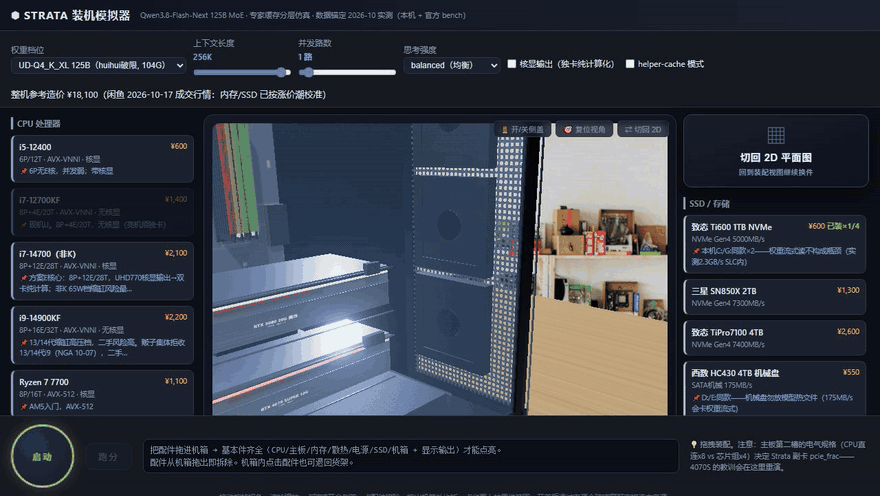

# Strata 装机模拟器（中文说明）

[English](README.md) · **简体中文**

[](https://piccatapro.github.io/strata-pc-simulator/)
[](LICENSE)
[](package.json)
[](test.js)

**装一台能跑本地大模型的机器，先看清楚它能跑多快。** 把真实配件拖进机箱、按下启动键，实时观察 decode 吞吐 / prefill / 首字延迟 / 专家驻留 / 温度功耗如何随硬件与推理参数变化——模型以 [Strata](https://github.com/Niko1221/Strata) MoE 推理引擎的真实实测数据校准。

- **买对的那张卡，而不是更大的那张**：第二张卡插进芯片组 `x4` 槽，整机可能被 `pcie_frac 0.25` 悄悄锁死。
- **每个数字都能追溯**：decode/prefill 常数由两台锚点机器解析求解，不是拟合出来的；`npm test` 会拦住漂移。
- **零运行时依赖**：原生 JS + Three.js，可内联成单个 HTML，双击离线也能跑。



**[🎮 打开在线 Demo](https://piccatapro.github.io/strata-pc-simulator/)** —— 不用装、不用编译，拖就行。

## 为什么做这个

在家用机上跑 100B+ MoE（Qwen Flash-Next 级别）是一道硬件均衡题：专家权重在显存 → 内存 → NVMe 三级之间流式调度，瓶颈往往不在你预期的地方。第二张卡插错 PCIe 槽会悄悄跑到 `pcie_frac 0.18` 拖垮整机；小显存卡会锁死 prompt chunk；AM5 上四条内存会静默降频到 3600。

本模拟器把这些规则写成显式的兼容性矩阵 + 用实测锚点标定的时间模型——花钱之前先在屏幕上把升级试一遍。

📝 **[为什么你的双卡只跑出单卡速度 →](docs/blog/2026-10-why-dual-gpu-slower.md)** —— 芯片组 x4 的坑，附实测数字。

## 功能

- **写实机箱视图**：主板托盘、按*电气*带宽（而非物理尺寸）着色的 PCIe 槽、逐槽内存渲染、M.2、电源仓、旋转风扇、开机插线动画。
- **真实配件参数**：P/E 核数、有无核显、AVX-512/AVX-VNNI、显存带宽、SM 数、PCIe 拆分表（CPU 直连 x8/x8 vs 芯片组 x4）、PL2 功耗墙、卡槽厚度、机箱限长。
- **POST 点灯规则**：CPU+主板+内存+散热+电源+存储+显示输出缺一不可（12700KF 无独卡点不亮）；DDR4/5 防呆；AM5 四槽降 3600；M.2 共享通道坑；电源 85% 负载线；16pin 接口数。
- **Strata 性能模型**：专家池三级驻留、命中率随上下文衰减、decode/prefill/TTFT、KV 占用、chunk 上限（issue #448）、batch 路径（issue #776）、CPU 侧 expert kernel（AVX-512/AVX-VNNI/AVX2）。
- **实时仪表盘**：CPU/GPU/显存/内存负载、各部件温度、整机功率，与权重量化、上下文长度、并发路数、思考强度全部联动。
- **36 项自动验算**（`npm test`）：实测锚点回归 + 矩阵边界用例。

## 快速开始

```bash
npm run serve               # → http://127.0.0.1:8080/src/index.html
npm install && npm run build # 生成单文件版 dist/strata-pc-simulator.html（3D 已内联，可离线双击）
npm test                    # 36 项验算
```

> ⚠️ **不要直接双击 `src/index.html`**：浏览器会拦掉 `file://` 下的 ES module，3D 起不来。
> 开发时用 `npm run serve`（**必须把仓库根目录当服务根**，因为 `index.html` 引用 `../vendor/` 和 `../assets/`）；
> 想要双击即用，就打开 `npm run build` 生成的单文件版。

## 数据出处与免责

- 硬件规格：厂商规格表。PCIe frac 映射：Strata 引擎自报实测口径。
- 基准：Strata 官方社区 bench + 作者自有实测机。
- 价格：闲鱼 2026-10 成交快照（人民币），已含 2026 下半年内存/NAND 涨价潮。行情价过时很快，只作相对比较。
- 这是**规划玩具**不是跑分器：绝对值 ±20%，它算不出你的硅 lottery。

## 许可证

MIT © 2026 铭铭
